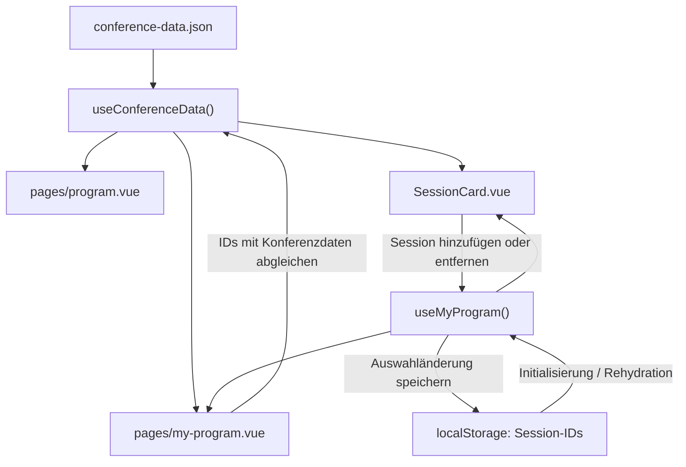
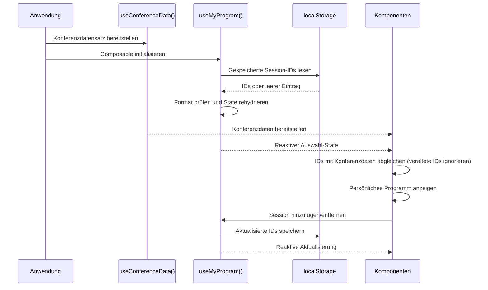

# State-Management-Konzept: „Mein Programm“ und `conference-data.json`

## 1. Gemeinsame Konferenzdaten

Die Plattform **Purrfect Conference** verwendet `conference-data.json` als zentralen, statischen Datensatz für die Konferenz. Darin werden die verfügbaren Sessions mit eindeutigen IDs und ihren Eigenschaften gespeichert, beispielsweise Titel, Abstract, Tag, Start- und Endzeit, Level und Format. Tracks, Räume und Speaker sind eigene Entitäten im Datensatz, auf die Sessions über IDs (`trackId`, `roomId`, `speakerIds`) verweisen. Die Daten werden über das Composable `useConferenceData()` bereitgestellt. Dieses lädt den Datensatz beim Start der Anwendung und stellt ihn reaktiv zur Verfügung. Bei einer statischen JSON-Datei, die direkt in die Anwendung importiert wird, übernimmt der Build-Prozess die Bereitstellung; ein zusätzlicher HTTP-Aufruf ist nicht erforderlich.

Die Seiten und Feature-Komponenten greifen auf dasselbe Composable zu, statt den Datensatz jeweils separat zu laden oder eigene Kopien anzulegen. Dadurch verwenden die Seite `pages/program.vue`, die Komponente `SessionCard.vue` und die Seite `pages/my-program.vue` eine einheitliche Datenquelle. Abgeleitete Daten, etwa eine gefilterte Session-Liste, werden aus dem gemeinsamen Datensatz berechnet und nicht als zusätzliche, unabhängige Kopie gespeichert.

## 2. Personalisierter State für „Mein Programm“

Die Auswahl der Nutzerin oder des Nutzers wird im Composable `useMyProgram()` verwaltet. Der State enthält ausschließlich eine Liste eindeutiger Session-IDs, zum Beispiel `["s01", "s12"]`, und nicht die vollständigen Session-Objekte. Diese Entscheidung vermeidet doppelte Datenhaltung und verhindert, dass gespeicherte Session-Objekte veralten, wenn sich die zentralen Konferenzdaten ändern.

Beim Initialisieren liest `useMyProgram()` die gespeicherten IDs aus `localStorage` und übernimmt sie in einen reaktiven State. Ist noch kein Eintrag vorhanden oder sind gespeicherte Daten ungültig, startet das Composable mit einer leeren Liste. Beim Hinzufügen oder Entfernen einer Session wird der reaktive State aktualisiert und anschließend in `localStorage` gespeichert. `useMyProgram()` prüft beim Lesen lediglich das Format der gespeicherten Daten (etwa, ob es sich um eine Liste von Strings handelt). IDs, die nicht mehr im Konferenzdatensatz vorkommen, werden erst beim Abgleich mit `useConferenceData()` in den Komponenten ignoriert; so bleibt das Composable von den Konferenzdaten entkoppelt.

## 3. Reaktivität und Zusammenspiel der Komponenten

Vue-Reaktivität sorgt dafür, dass Komponenten, die den State von `useMyProgram()` verwenden, nach einer Änderung automatisch aktualisiert werden. `SessionCard.vue` kann anhand der Session-ID erkennen, ob eine Session bereits ausgewählt ist, und die passende Schaltfläche anzeigen. Die Seite `my-program.vue` ermittelt die vollständigen Session-Objekte, indem sie die gespeicherten IDs mit dem Datensatz aus `useConferenceData()` abgleicht. So bleiben Auswahl und Konferenzdaten logisch getrennt, können aber gemeinsam dargestellt werden.

## 4. Laden, Speichern und Rehydration

Die gemeinsamen Konferenzdaten stehen beim Anwendungsstart zur Verfügung. Der personalisierte State wird beim Initialisieren von `useMyProgram()` aus `localStorage` wiederhergestellt. Danach werden Änderungen an der Auswahl zeitnah gespeichert. Beim Neuladen des Browsers wird der Composable-State neu aufgebaut und mit den gespeicherten IDs rehydriert. Die Auswahl bleibt dadurch auf demselben Browser und Gerät erhalten; eine Synchronisation zwischen verschiedenen Geräten oder Nutzerkonten ist ohne Backend nicht vorgesehen.

## 5. Datenflussdiagramm

## 6. Sequenzdiagramm beim Neuladen

