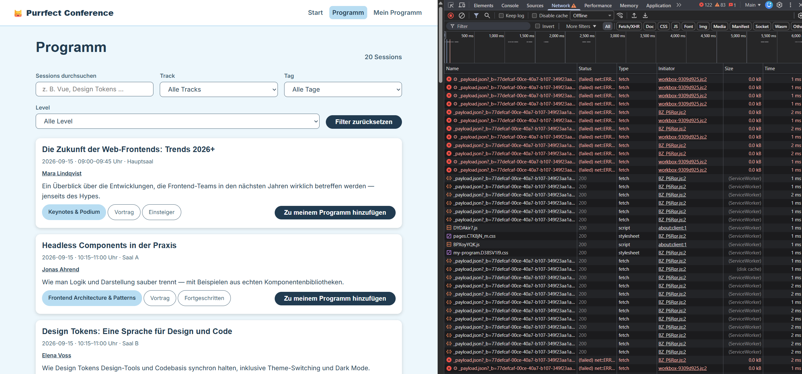
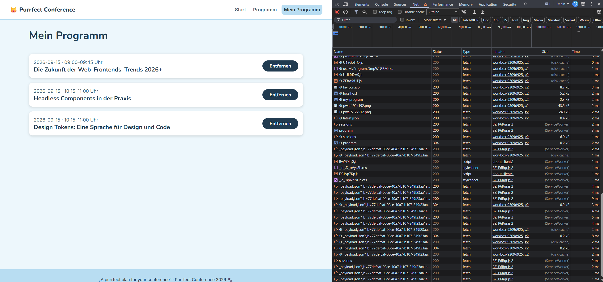
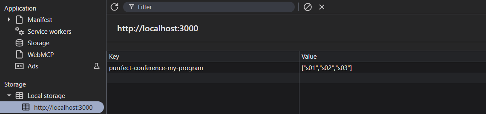
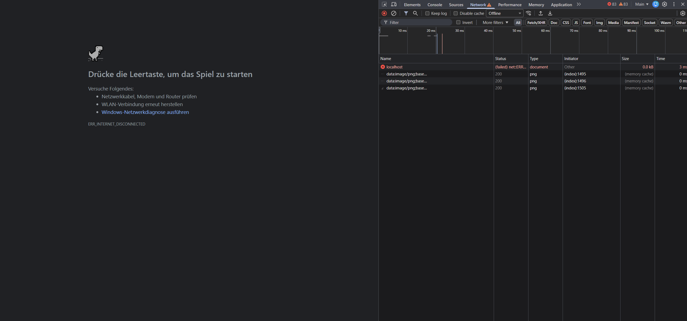
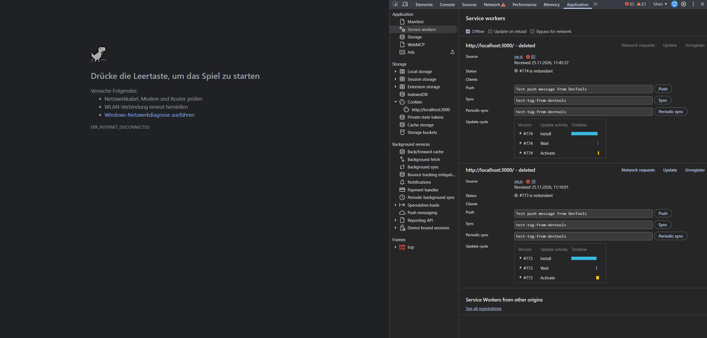
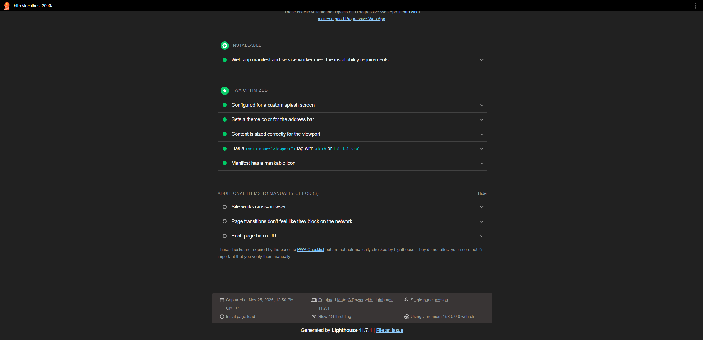

# Aufgabe E – Verifikations-Nachweis

## Testaufbau

- Produktions-Build (`npm run build`, `npm run preview`) unter `http://localhost:3000`, Chrome 158 und Microsoft Edge unter Windows 11. Die Screenshots stammen aus Chrome, Edge verhielt sich in allen Szenarien gleich.
- Offline geschaltet über DevTools → Network → „Offline“, vor jedem Szenario Website-Daten gelöscht (Application → Storage → „Clear site data“)
- PWA-Audit mit Lighthouse 11.7.1 per Kommandozeile: `npx lighthouse@11.7.1 http://localhost:3000/ --only-categories=pwa`. Das in Chrome eingebaute Lighthouse ab Version 12 hat keine PWA-Kategorie mehr.

## Szenario 1 – Session-Übersicht offline

Der Network-Tab steht auf „Offline“, die Seite zeigt alle 20 Sessions. In der Spalte Size steht „(ServiceWorker)“: Die Antworten kommen aus dem Cache.
Die roten Einträge sind `_payload.json`-Dateien, die Nuxt für sichtbare Links im Voraus anfragt. Für Sessions, die nie geöffnet wurden, liegen sie nicht im Cache. Auf die Anzeige der Übersicht hat das keinen Einfluss.

## Szenario 2 – „Mein Programm“ offline

„Mein Programm“ zeigt offline alle drei gespeicherten Sessions mit Tag und Uhrzeit. Die IDs `s01`, `s02` und `s03` liegen im localStorage.
Im Network-Log kommen `sessions` (die API `/api/sessions`) und `program` aus dem Service Worker. Die mit einem Zahnrad markierten Einträge hat der Service Worker selbst angefragt, als er noch online war: den Precache bei der Installation und das Vorab-Laden von `/api/sessions` und `/program`.

## Szenario 3 – Erstbesuch offline

Das Dokument `localhost` scheitert mit `ERR_INTERNET_DISCONNECTED`, Chrome zeigt seine Fehlerseite.
Unter Application → Service Workers gibt es nur noch gelöschte Registrierungen mit dem Status „redundant“, also keinen aktiven Service Worker. Das entspricht einem Erstbesuch.

## Lighthouse-PWA-Audit

Vollständiger Report: [lighthouse-pwa-report.html](nachweise/lighthouse-pwa-report.html) (Lighthouse 11.7.1, Chromium 158, 25.11.2026, 12:59)

| Prüfung | Ergebnis | Bedeutung |
|---|---|---|
| Installierbarkeit | bestanden | Das Manifest ist gültig: Name, Icons (192 und 512 px), `start_url` und `display: standalone` erfüllen Chromes Anforderungen |
| Splash-Screen | bestanden | Name, Hintergrundfarbe und 512-px-Icon sind vorhanden |
| `theme-color` für die Adressleiste | bestanden | `<meta name="theme-color">` mit demselben Wert wie `theme_color` im Manifest |
| Viewport und Inhaltsbreite | bestanden | Die Seite passt sich der Bildschirmbreite an |
| Maskierbares Icon | bestanden | Eigenes Icon mit `purpose: "maskable"`, das Motiv liegt in der sicheren Zone |

Der erste Lauf zeigte zwei Mängel: Im HTML fehlte der `theme-color`-Tag, und es gab kein maskierbares Icon.
Beides haben wir ergänzt (`nuxt.config.ts`, `public/maskable-icon-512x512.png`), danach bestanden alle automatischen Prüfungen.
Die drei manuellen Punkte am Ende des Reports bewertet Lighthouse nicht.

## Service-Worker-Erkennung

Seit Chromes aktualisierten Installierbarkeitskriterien ist ein Service Worker keine Voraussetzung mehr für die Installation, Lighthouse 11 prüft ihn deshalb nicht separat.
Dass Chrome den Service Worker erkennt und er die Seite kontrolliert, zeigen die Screenshots zu Szenario 1 und 2:
Antworten mit „(ServiceWorker)“ in der Spalte Size gibt es nur, wenn ein aktiver Service Worker sie liefert. Die Einträge mit Initiator `workbox-9309d925.js` hat der Service Worker selbst angefragt.
Der Screenshot zu Szenario 3 zeigt außerdem die Registrierung von `sw.js` unter Application → Service Workers.

## Einordnung

Getestet haben wir den Produktions-Build in Chrome 158 und Microsoft Edge unter Windows 11, beide Browser verhielten sich gleich. Vor jedem Szenario haben wir die Website-Daten gelöscht. Für Szenario 1 und 2 haben wir die App danach einmal online geöffnet und anschließend in den DevTools auf „Offline“ geschaltet, was für den Browser dem Flugmodus entspricht. Installierbarkeit und Manifest haben wir mit Lighthouse 11 geprüft.
Die Screenshots zeigen, dass Session-Übersicht und „Mein Programm“ nach einem einzigen Online-Besuch offline vollständig funktionieren. Die Antworten kommen sichtbar vom Service Worker, Filter und Hinzufügen arbeiten weiter, und die Auswahl bleibt im localStorage erhalten. Beim Erstbesuch ohne Netz erscheint wie erwartet die Fehlerseite des Browsers, weil noch kein Service Worker installiert ist. Lighthouse bestätigt nach zwei Korrekturen alle automatischen PWA-Prüfungen.
Lücken bestehen an zwei Stellen. Nie geöffnete Session-Detailseiten sind offline nicht verfügbar, ein Klick darauf zeigt einen leeren Inhaltsbereich. Außerdem basieren Chrome und Edge beide auf Chromium. Safari und Firefox, die Service Worker und Speicher anders verwalten, sowie ein echtes Smartphone im Flugmodus stehen noch aus.
